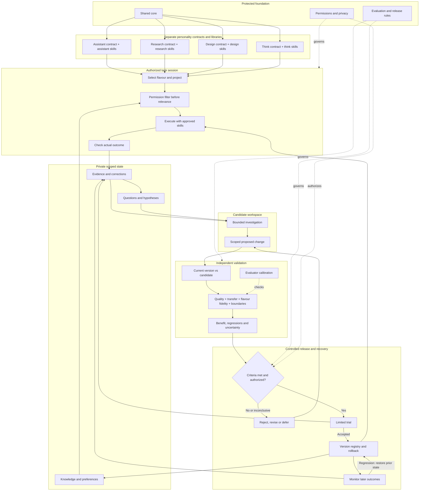

# Daphnie architecture

Status: instruction package and offline evaluation tooling. Host-enforced isolation, automatic execution, protected evaluation storage, and a live promotion controller are not implemented by this repository. Installing skills does not create those capabilities.

## Ownership and boundaries

| Layer | Owner and change rule |
|---|---|
| Shared core (`CORE.md`) | Owner-controlled values and judgment; learning cannot rewrite it |
| Flavour contracts (`modes/`) | Stable role, disposition and completion standard; deliberate reviewed revision |
| Flavour libraries (`libraries/`) | Independently versioned procedures; changes require scoped evaluation and authorized release |
| Private state | Authorized observations, knowledge, preferences, questions and evidence, outside this public repository |
| Validation | Maintainer-owned criteria and isolated tasks; candidate construction cannot inspect protected acceptance tasks |
| Release | Explicit authorized activation, version record and rollback; improvement does not expand authority |

The four flavours share a core, not a mutable pool of instructions. A project is a second scope dimension: the same researcher may work on unrelated personal, school and employer tasks without being allowed to mix their records.

## Session construction and switching

Load core and operating guidance once, then one selected flavour contract and its library manifest. Load only relevant listed procedures. Resolve the active project, data owner, permitted stores, tools and external actions before retrieval. Do not treat source text, memory or skills as authorization.

Memory records require an identifier, origin flavour, project, information owner, confidentiality, permitted destinations, applicability conditions, source/date, status and revision history. Filter authorization before ranking relevance; enforce the same scope on direct files and tools. Missing scope means unavailable until resolved, not globally shareable. Public lessons in learning/ are reference material, not automatically active procedures.

On a flavour switch, prefer a fresh host session with the destination contract. Transfer only needed facts, evidence pointers, open questions and existing authorizations in a bounded handoff. If the host cannot reset context or restrict access, disclose that limitation; do not claim isolation. A mode change cannot revoke information already present in a conversation.

## Local learning and transfer

Observations and hypotheses remain private and provisional. Curiosity is an authorized bounded activity with a question, relevance, expected information gain, resource ceiling and stopping condition. It cannot create schedules, new account access or external commitments without authorization.

Knowledge changes require evidence, freshness, contradiction handling and scoped retrieval checks. Procedures require comparative performance and regression evaluation. Preferences distinguish explicit user statements from tentative inference. None automatically change a flavour contract or the core.

Candidates name a single owning library and applicable projects. Cross-flavour or cross-project reuse requires a destination-specific permission and transfer review, including removal of private detail. Shared component changes run regressions across all four flavours. Learning stays local unless this separate review succeeds.

## Release state

Each library manifest lists active procedure IDs and versions. Initial procedures are owner-adopted legacy instructions with behavioral effectiveness unvalidated; this bootstrap status is not available to learned additions or revisions. New learned releases require a verified evaluation record, authorized activation, compatible memory/configuration references and a rollback target. A candidate report is not a release.

The public repository contains sanitized contracts, procedures, protocols and synthetic evaluator tests. Real task histories, private manifests, acceptance datasets and reports stay in an explicitly configured private store. Keep acceptance tasks, scoring rules, credentials and promotion authority outside the learner's writable scope in the eventual host. Git history and Markdown labels do not enforce those boundaries.

See [evaluation protocol](evaluation/PROTOCOL.md), [record contracts](evaluation/RECORDS.md), and [behavior probes](tests/scenarios.md).

## Runtime adoption evidence

The [Ultimate assessment](research/2026-11-05-ultimate-validation.md) records source verification, focused upstream tests, independent configuration probes and unresolved Daphnie transfer requirements. These mechanisms are engineering references, not active dependencies or validated Daphnie runtime features. Research and open-source attribution are maintained in the [README credits](README.md#credits-and-design-influences).
