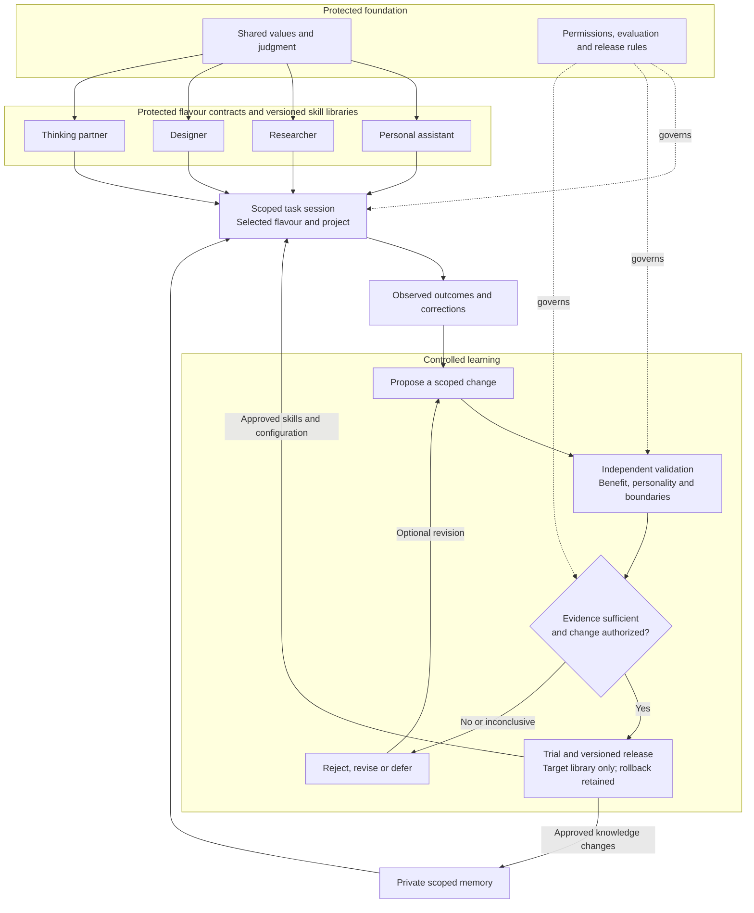

# Daphnie
Canonical public instructions: [akaiyol/daphnie](https://github.com/akaiyol/daphnie). Four focused modes share one [personality and judgment core](CORE.md). [Operating instructions](OPERATING.md), goals, project context and memory are separate. Private Markdown personal/project notes live outside this repository; public learning contains only reviewed, sanitized lessons.

## Use
Keep a canonical checkout. Run `python3 scripts/check.py`, then `python3 scripts/install.py` to link its five skills into `~/.codex/skills`. The installer refuses unknown existing entries; review conflicts manually. Use `--destination DIRECTORY` for another skills folder. Moving the checkout requires relinking.

Invoke `$daphnie` to route a request, or use `$daphnie-design`, `$daphnie-think`, `$daphnie-assistant`, `$daphnie-research` directly. Core and operating guidance load once; only the selected mode is read. Goals, project state and memory are context, not personality. An existing `~/.codex/daphnie/INDEX.md` is opt-in private-store configuration; otherwise configure a private store before recording personal notes.

For alternating Mac/Windows use, follow the [cross-device setup](evaluation/CROSS_DEVICE.md). `scripts/handoff.py` shares private Markdown project memory through a separate private repository, pins the package commit and records the active device. Windows uses WSL2. This explicit handoff does not replicate Codex sessions, generated memory or controller databases; live Windows recall remains unverified.

[Maintenance guidance](MAINTENANCE.md) requires useful corrections to reach authorized file repairs or exact scoped skill candidates; recording a lesson alone is insufficient. Daphnie owns [task-driven update follow-through](SELF_UPDATE.md) within existing task budgets and a preapproved host policy. Behavioral promotion still requires evaluation and an authorized release.

[Delegation](DELEGATION.md) is a separate owner-approved capability: Daphnie may select useful bounded workers within the existing task budget and remains accountable for their results. The contract does not supply a standalone dispatcher or enforced worker isolation.

## Architecture and learning

High-level target architecture. The local controller implements explicit capture, development comparisons, manual adoption and signed trial/promotion gates. Enforced context isolation and production reviewer integration require a separate host. Solid arrows show work and learning; dotted arrows show governance.

See the [complete architecture](ARCHITECTURE.md) for ownership, context isolation, monitoring and recovery.

Four protected flavour contracts share one core. Each flavour has its own [versioned skill library](libraries/assistant/manifest.json): [assistant](libraries/assistant/manifest.json), [research](libraries/research/manifest.json), [design](libraries/design/manifest.json), and [think](libraries/think/manifest.json). Load only the selected flavour and relevant active procedures. Initial procedures are owner-adopted baselines; behavioral effectiveness is unvalidated.

The [architecture](ARCHITECTURE.md) defines personality/project separation, private scoped memory, controlled learning, independent validation, trial releases and rollback. The [evaluation protocol](evaluation/PROTOCOL.md) and [record contracts](evaluation/RECORDS.md) govern future verified updates. Cross-flavour learning requires a separate destination review. Core, contracts, permissions and evaluator rules are owner controlled.

Run `python3 scripts/check.py` and `python3 -m unittest discover -s tests -p 'test_*.py'`. Review paired procedural outcomes with `python3 scripts/evaluate.py INPUT.json --output REPORT.json`, using private paths for actual evidence. The report checks supplied records; it does not run an agent or activate changes.

The [local controller](evaluation/CONTROLLER.md) now records scoped observations and exact file snapshots, groups proposed evidence, creates separate candidate workspaces, runs paired development tasks, scores artifacts and preserves comparison history. Updates are fetched and imported explicitly; manual adoption requires an explicit operator decision; signed releases and trial rollback can proceed under a separately approved host policy. See the [target design and implementation boundary](evaluation/BENCHMARK_SYSTEM.md) and [validation record](research/2026-11-05-controller-validation.md).

## Experimental scoped memory

The [files-and-SQL memory baseline](evaluation/MEMORY_BASELINE.md) adds explicit private stores, bounded indexes, corrections, expiry and deletion. A six-scenario comparison holds the skill package constant and varies supplied memory. It does not enable automatic memory use or autonomous updates.

## Lifecycle model checking

The [skill lifecycle verification](verification/skill_lifecycle/README.md) checks a finite TLA+ model, runs negative controls and replays concrete witnesses against disposable controller state. The race is resolved with snapshot deployments, and signed evaluation, trial and release gates are implemented. Bounded checks pass; production trust and live improvement remain unverified. See the [one-time release policy](evaluation/RELEASE_POLICY.md).

## Verification limits

Latest local verification (2026-11-08): the package checker, all 93 unit/integration tests and the bounded lifecycle harness passed.

The package checker checks structure and library metadata. Synthetic unit tests check controller and offline evaluation decisions; neither establishes task quality, personality preservation or resistance to poisoning. [Behavior probes](tests/scenarios.md) require observed outcomes. The [eight-attempt lifecycle drill](research/2026-11-05-lifecycle-validation.md) completed across all four flavours with no measured quality difference. Results remain inconclusive; live improvement is unverified.

The controller is invoked during authorized tasks. [Self-update guidance](SELF_UPDATE.md) assigns update follow-through to Daphnie within existing budgets; `advance-update` selects release phases when trusted evidence is supplied. Ordinary calls have no host-enforced trigger to log, benchmark, pull updates or activate changes. It provides no autonomous scheduler, enforced access isolation, protected acceptance store, production review service, model training, universal chat access or sleep/wake guarantee. Those require a separately configured host. Reading schedules require an explicit request and actual delivery verification.

## Credits and design influences

Daphnie's architecture is a synthesis of the work below. These are intellectual and engineering influences, not claims that their authors endorse Daphnie or that their results validate this implementation. Research findings remain bounded by each paper's tested models, tasks and methods.

### Research informing the learning architecture

| Work and authors | Contribution to Daphnie's design |
|---|---|
| [Large Language Model Agents Are Not Always Faithful Self-Evolvers](https://proceedings.mlr.press/v306/zhao26aw.html) — Weixiang Zhao et al., ICML 2026 | Test whether experience meaningfully affects decisions; retain supporting evidence alongside condensed lessons. |
| [Harness Updating Is Not Harness Benefit](https://aclanthology.org/2026.emnlp-main.2326/) — Minhua Lin et al., EMNLP 2026 | Evaluate writing an update separately from retrieving, applying and benefiting from it. |
| [EvoMemBench](https://arxiv.org/abs/2605.18421v3) — Yuyao Wang et al., 2026 | Separate knowledge from execution memory and within-task from cross-task learning; compare with simple context baselines. |
| [MemForm](https://arxiv.org/abs/2610.14431v1) — Haowen Pan et al., 2026 preprint | Evaluate scope, evidence selection and consolidation order, as well as stored content, for memory poisoning. |
| [The Consistency Dilemma in LLMs](https://proceedings.mlr.press/v306/mancoridis26a.html) — Marina Mancoridis and Zoë Hitzig, ICML 2026 | Do not treat an agent agreeing with its own judgment as independent verification. |

### Subsequent research review

These works informed the later review of instruction files and executable harnesses; they are not retroactive sources for earlier implementation decisions.

| Work and authors | Implication under consideration |
|---|---|
| [Evaluating AGENTS.md](https://arxiv.org/abs/2602.11988v3) — Thibaud Gloaguen et al., 2026 | Keep guidance selective and evaluate its marginal value; additional instructions can add cost without improving success. |
| [SkillsBench](https://arxiv.org/abs/2602.12670v4) — Xiangyi Li et al., 2026 | Compare curated skills with no-skill baselines. Skill packages may include executable resources; their benefit does not prove Markdown alone is best. |
| [SWE-agent](https://arxiv.org/abs/2405.15793v3) — John Yang et al., 2024 | Tool interfaces, guardrails and feedback are part of agent capability, alongside instructions. |
| [DSPy](https://arxiv.org/abs/2310.03714) — Omar Khattab et al., 2023 preprint; ICLR 2024 | Evaluate and optimize composed workflows rather than relying exclusively on manually accumulated prompts. |

### Subsequent memory experiment

[Millin Gabani’s proposal](https://x.com/trillhause_/status/2087746105509331132) motivated the files-and-SQL baseline with a bounded memory index. The post proposes an experiment; it does not establish effectiveness or an optimal budget. See the [experiment design](evaluation/MEMORY_BASELINE.md).

### Subsequent delegation and evaluation review

[Addy Osmani](https://x.com/addyosmani/status/2119332146485891501) and [Sergii Makarevych](https://x.com/sermakarevich/status/2106453816757354947) informed the later review of coordination ownership and evaluator validity. The [source review](research/2026-11-08-delegation-and-evaluation-research.md) credits the independent agent-scaling, MAST and GAUGE papers, records their limitations, and excludes a withdrawn citation. These sources do not retroactively establish the earlier design or demonstrate Daphnie’s performance.

### Open-source engineering references

- [pstack](https://github.com/cursor/plugins/tree/6b0300214a09fd6029cfb7077043125758cd1fd2/pstack), by poteto and contributors: the later [Laziness Protocol](https://github.com/cursor/plugins/blob/6b0300214a09fd6029cfb7077043125758cd1fd2/pstack/skills/principle-laziness-protocol/SKILL.md), [Subtract Before You Add](https://github.com/cursor/plugins/blob/6b0300214a09fd6029cfb7077043125758cd1fd2/pstack/skills/principle-subtract-before-you-add/SKILL.md) and [Encode Lessons in Structure](https://github.com/cursor/plugins/blob/6b0300214a09fd6029cfb7077043125758cd1fd2/pstack/skills/principle-encode-lessons-in-structure/SKILL.md) informed scoped operating refinements and executable repairs. See [adoption and mandate check](learning/journal/2026-11-08-minimal-effective-changes.md). Daphnie's existing core principles predate this adoption; no pstack runtime is installed.
- [Ultimate](https://github.com/HazAT/ultimate), by Daniel Griesser (HazAT) and contributors: subsequent runtime reference for executable agent configurations, traceable context, durable execution, evidence-linked reflection and checked releases. Reviewed revision: [`29f3db4`](https://github.com/HazAT/ultimate/tree/29f3db4e76d888d305ab8ce33fd7f1db793c9d1a). See the [verification and adoption assessment](research/2026-11-05-ultimate-validation.md) for tested mechanisms, limitations and Daphnie-specific acceptance requirements.
- [Pi / Pi Durable](https://github.com/earendil-works/pi/tree/main/packages/durable), by the Earendil Works contributors: the upstream durable execution framework on which Ultimate builds. This is upstream credit, not a Daphnie dependency or a claim of an independent framework audit.
- [SkillsBench implementation](https://github.com/benchflow-ai/skillsbench), [SWE-agent implementation](https://github.com/SWE-agent/SWE-agent), and [DSPy implementation](https://github.com/stanfordnlp/dspy): companion engineering references for the research above; not integrated dependencies.

No Ultimate or Pi source code has been incorporated into Daphnie in this review. Their mechanisms remain adoption candidates. Ultimate is MIT licensed, copyright 2026 Daniel Griesser; any later source reuse must retain its applicable copyright and license notices. Acknowledgment alone does not replace license compliance.
