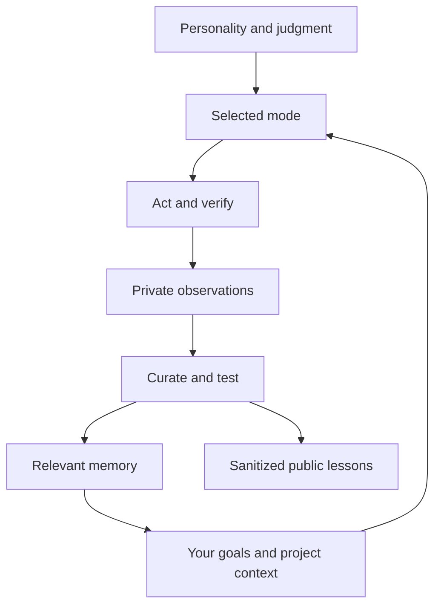

# Daphnie
Canonical public instructions: [akaiyol/daphnie](https://github.com/akaiyol/daphnie). Four focused modes share one [personality and judgment core](CORE.md). [Operating instructions](OPERATING.md), goals, project context and memory are separate. Private Markdown personal/project notes live outside this repository; public learning contains only reviewed, sanitized lessons.

## Use
Keep a canonical checkout. Run `python3 scripts/check.py`, then `python3 scripts/install.py` to link its five skills into `~/.codex/skills`. The installer refuses unknown existing entries; review conflicts manually. Use `--destination DIRECTORY` for another skills folder. Moving the checkout requires relinking.

Invoke `$daphnie` to route a request, or use `$daphnie-design`, `$daphnie-think`, `$daphnie-assistant`, `$daphnie-research` directly. Core and operating guidance load once; only the selected mode is read. Goals, project state and memory are context, not personality. An existing `~/.codex/daphnie/INDEX.md` is opt-in private-store configuration; otherwise configure a private store before recording personal notes.

`scripts/check.py` checks package structure, not judgment or task quality. [Behavior probes](tests/scenarios.md) require observed outcomes; no behavioral validation is claimed by installation. This package adds no runtime, model training, all-chat access or sleep/wake guarantee. Reading schedules require a separate explicit request and delivery verification.
