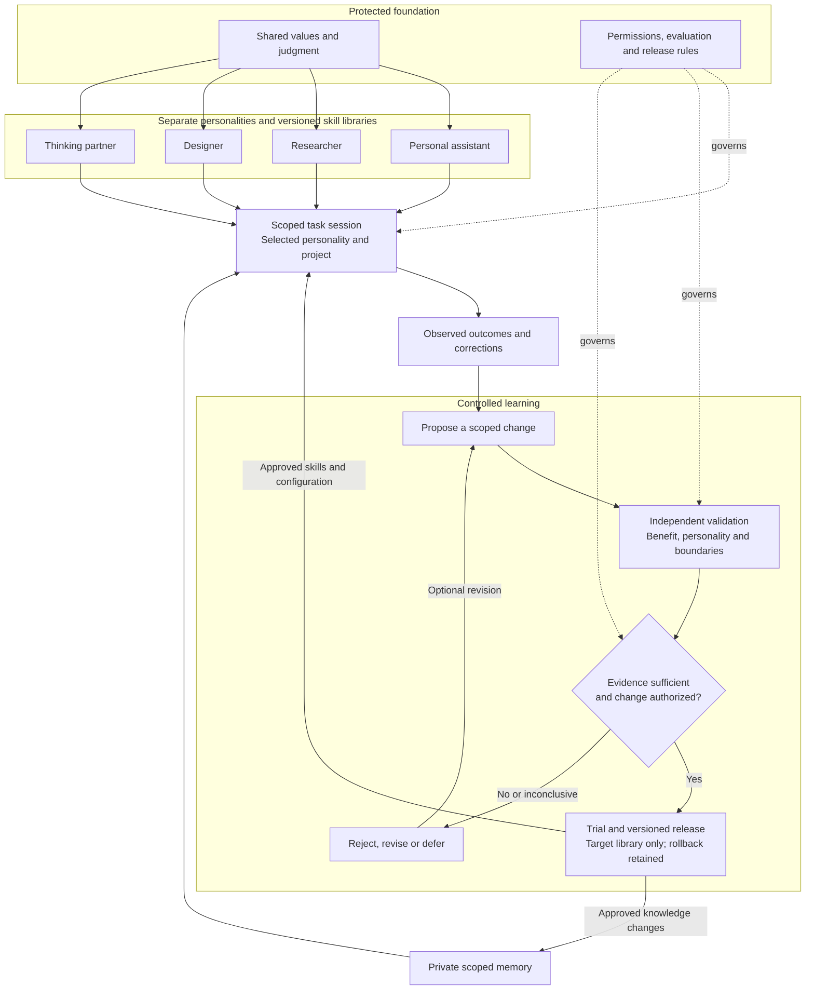

# Daphnie
Canonical public instructions: [akaiyol/daphnie](https://github.com/akaiyol/daphnie). Four focused modes share one [personality and judgment core](CORE.md). [Operating instructions](OPERATING.md), goals, project context and memory are separate. Private Markdown personal/project notes live outside this repository; public learning contains only reviewed, sanitized lessons.

## Use
Keep a canonical checkout. Run `python3 scripts/check.py`, then `python3 scripts/install.py` to link its five skills into `~/.codex/skills`. The installer refuses unknown existing entries; review conflicts manually. Use `--destination DIRECTORY` for another skills folder. Moving the checkout requires relinking.

Invoke `$daphnie` to route a request, or use `$daphnie-design`, `$daphnie-think`, `$daphnie-assistant`, `$daphnie-research` directly. Core and operating guidance load once; only the selected mode is read. Goals, project state and memory are context, not personality. An existing `~/.codex/daphnie/INDEX.md` is opt-in private-store configuration; otherwise configure a private store before recording personal notes.

## Architecture and learning

High-level target architecture; the runtime and enforcement components remain to be built. Solid arrows show work and learning; dotted arrows show governance.

See the [complete architecture](ARCHITECTURE.md) for ownership, context isolation, monitoring and recovery.

Four protected flavour contracts share one core. Each flavour has its own [versioned skill library](libraries/assistant/manifest.json): [assistant](libraries/assistant/manifest.json), [research](libraries/research/manifest.json), [design](libraries/design/manifest.json), and [think](libraries/think/manifest.json). Load only the selected flavour and relevant active procedures. Initial procedures are owner-adopted baselines; behavioral effectiveness is unvalidated.

The [architecture](ARCHITECTURE.md) defines personality/project separation, private scoped memory, controlled learning, independent validation, trial releases and rollback. The [evaluation protocol](evaluation/PROTOCOL.md) and [record contracts](evaluation/RECORDS.md) govern future verified updates. Cross-flavour learning requires a separate destination review. Core, contracts, permissions and evaluator rules are owner controlled.

Run `python3 scripts/check.py` and `python3 -m unittest discover -s tests -p 'test_*.py'`. Review paired procedural outcomes with `python3 scripts/evaluate.py INPUT.json --output REPORT.json`, using private paths for actual evidence. The report checks supplied records; it does not run an agent or activate changes.

## Verification limits

The package checker checks structure and library metadata. Synthetic unit tests check offline evaluation decisions; neither establishes task quality, personality preservation or resistance to poisoning. [Behavior probes](tests/scenarios.md) require observed outcomes. No learned update or live learning cycle has been validated.

This package provides no autonomous runtime, enforced access isolation, protected acceptance store, release controller, model training, universal chat access or sleep/wake guarantee. Those require a separately configured host. Reading schedules require an explicit request and actual delivery verification.
