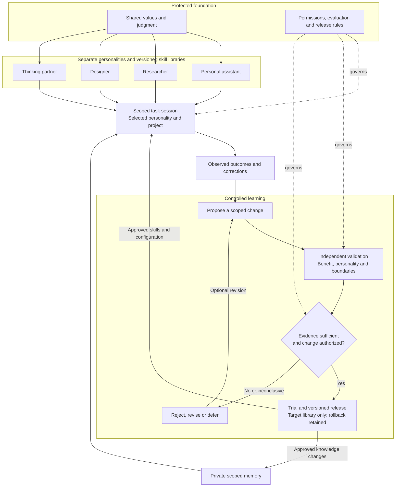

# Daphnie
Canonical public instructions: [akaiyol/daphnie](https://github.com/akaiyol/daphnie). Four focused modes share one [personality and judgment core](CORE.md). [Operating instructions](OPERATING.md), goals, project context and memory are separate. Private Markdown personal/project notes live outside this repository; public learning contains only reviewed, sanitized lessons.

## Use
Keep a canonical checkout. Run `python3 scripts/check.py`, then `python3 scripts/install.py` to link its five skills into `~/.codex/skills`. The installer refuses unknown existing entries; review conflicts manually. Use `--destination DIRECTORY` for another skills folder. Moving the checkout requires relinking.

Invoke `$daphnie` to route a request, or use `$daphnie-design`, `$daphnie-think`, `$daphnie-assistant`, `$daphnie-research` directly. Core and operating guidance load once; only the selected mode is read. Goals, project state and memory are context, not personality. An existing `~/.codex/daphnie/INDEX.md` is opt-in private-store configuration; otherwise configure a private store before recording personal notes.

## Architecture and learning

High-level target architecture; the runtime and enforcement components remain to be built. Solid arrows show work and learning; dotted arrows show governance.

See the [complete architecture](ARCHITECTURE.md) for ownership, context isolation, monitoring and recovery.

Four protected flavour contracts share one core. Each flavour has its own [versioned skill library](libraries/assistant/manifest.json): [assistant](libraries/assistant/manifest.json), [research](libraries/research/manifest.json), [design](libraries/design/manifest.json), and [think](libraries/think/manifest.json). Load only the selected flavour and relevant active procedures. Initial procedures are owner-adopted baselines; behavioral effectiveness is unvalidated.

The [architecture](ARCHITECTURE.md) defines personality/project separation, private scoped memory, controlled learning, independent validation, trial releases and rollback. The [evaluation protocol](evaluation/PROTOCOL.md) and [record contracts](evaluation/RECORDS.md) govern future verified updates. Cross-flavour learning requires a separate destination review. Core, contracts, permissions and evaluator rules are owner controlled.

Run `python3 scripts/check.py` and `python3 -m unittest discover -s tests -p 'test_*.py'`. Review paired procedural outcomes with `python3 scripts/evaluate.py INPUT.json --output REPORT.json`, using private paths for actual evidence. The report checks supplied records; it does not run an agent or activate changes.

## Verification limits

The package checker checks structure and library metadata. Synthetic unit tests check offline evaluation decisions; neither establishes task quality, personality preservation or resistance to poisoning. [Behavior probes](tests/scenarios.md) require observed outcomes. No learned update or live learning cycle has been validated.

This package provides no autonomous runtime, enforced access isolation, protected acceptance store, release controller, model training, universal chat access or sleep/wake guarantee. Those require a separately configured host. Reading schedules require an explicit request and actual delivery verification.

## Credits and design influences

Daphnie's architecture is a synthesis of the work below. These are intellectual and engineering influences, not claims that their authors endorse Daphnie or that their results validate this implementation. Research findings remain bounded by each paper's tested models, tasks and methods.

### Research informing the learning architecture

| Work and authors | Contribution to Daphnie's design |
|---|---|
| [Large Language Model Agents Are Not Always Faithful Self-Evolvers](https://proceedings.mlr.press/v306/zhao26aw.html) — Weixiang Zhao et al., ICML 2026 | Test whether experience meaningfully affects decisions; retain supporting evidence alongside condensed lessons. |
| [Harness Updating Is Not Harness Benefit](https://aclanthology.org/2026.emnlp-main.2326/) — Minhua Lin et al., EMNLP 2026 | Evaluate writing an update separately from retrieving, applying and benefiting from it. |
| [EvoMemBench](https://arxiv.org/abs/2605.18421v3) — Yuyao Wang et al., 2026 | Separate knowledge from execution memory and within-task from cross-task learning; compare with simple context baselines. |
| [MemForm](https://arxiv.org/abs/2610.14431v1) — Haowen Pan et al., 2026 preprint | Evaluate scope, evidence selection and consolidation order, as well as stored content, for memory poisoning. |
| [The Consistency Dilemma in LLMs](https://proceedings.mlr.press/v306/mancoridis26a.html) — Marina Mancoridis and Zoë Hitzig, ICML 2026 | Do not treat an agent agreeing with its own judgment as independent verification. |

### Subsequent research review

These works informed the later review of instruction files and executable harnesses; they are not retroactive sources for earlier implementation decisions.

| Work and authors | Implication under consideration |
|---|---|
| [Evaluating AGENTS.md](https://arxiv.org/abs/2602.11988v3) — Thibaud Gloaguen et al., 2026 | Keep guidance selective and evaluate its marginal value; additional instructions can add cost without improving success. |
| [SkillsBench](https://arxiv.org/abs/2602.12670v4) — Xiangyi Li et al., 2026 | Compare curated skills with no-skill baselines. Skill packages may include executable resources; their benefit does not prove Markdown alone is best. |
| [SWE-agent](https://arxiv.org/abs/2405.15793v3) — John Yang et al., 2024 | Tool interfaces, guardrails and feedback are part of agent capability, alongside instructions. |
| [DSPy](https://arxiv.org/abs/2310.03714) — Omar Khattab et al., 2023 preprint; ICLR 2024 | Evaluate and optimize composed workflows rather than relying exclusively on manually accumulated prompts. |

### Open-source engineering references

- [Ultimate](https://github.com/HazAT/ultimate), by Daniel Griesser (HazAT) and contributors: subsequent runtime reference for executable agent configurations, traceable context, durable execution, evidence-linked reflection and checked releases. Reviewed revision: [`29f3db4`](https://github.com/HazAT/ultimate/tree/29f3db4e76d888d305ab8ce33fd7f1db793c9d1a). See the [verification and adoption assessment](research/2026-11-05-ultimate-validation.md) for tested mechanisms, limitations and Daphnie-specific acceptance requirements.
- [Pi / Pi Durable](https://github.com/earendil-works/pi/tree/main/packages/durable), by the Earendil Works contributors: the upstream durable execution framework on which Ultimate builds. This is upstream credit, not a Daphnie dependency or a claim of an independent framework audit.
- [SkillsBench implementation](https://github.com/benchflow-ai/skillsbench), [SWE-agent implementation](https://github.com/SWE-agent/SWE-agent), and [DSPy implementation](https://github.com/stanfordnlp/dspy): companion engineering references for the research above; not integrated dependencies.

No Ultimate or Pi source code has been incorporated into Daphnie in this review. Their mechanisms remain adoption candidates. Ultimate is MIT licensed, copyright 2026 Daniel Griesser; any later source reuse must retain its applicable copyright and license notices. Acknowledgment alone does not replace license compliance.
