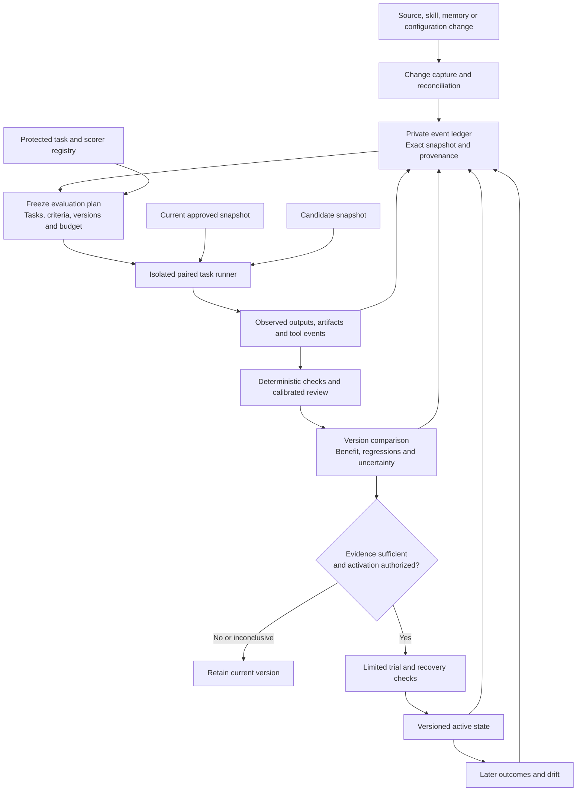

# Change ledger and longitudinal benchmark

Status: target design with a functional local v1, 2026-11-05. [Controller operations](CONTROLLER.md) document the implemented subset: explicit snapshots, scoped observations and grouping, separate candidates, frozen development plans, subprocess execution, artifact scoring, private history, exact Git imports and manual adoption/rollback. Automatic verified promotion is blocked. Existing `scripts/evaluate.py` remains an offline reviewer of supplied acceptance records.

## Objective and scope

Every registered change should be traceable to its exact contents, reason, affected flavour/context, measured outcomes and activation history. The system must distinguish useful improvement, regression, equivalent behavior and insufficient evidence. It must also detect when a model, tool, evaluator or benchmark changed, so those changes are not misattributed to learning.

“All changes” means changes inside registered source/configuration roots, private memory APIs and instrumented host sessions. It does not mean universal access to chats or files. Filesystem notifications are advisory: reconcile registered content at startup and before/after each benchmark or activation. Out-of-band changes found later are logged as discovered changes with unknown author/reason where necessary, never reconstructed as certain history. Unobserved activity in an unmanaged host is outside coverage.

## System boundary

The learner can submit changes and read permitted development feedback. A separate controller owns acceptance task access, scoring, run identity, comparison decisions and activation. OS/service permissions must make this separation real. A shared unrestricted shell or filesystem would invalidate a claim that the learner cannot alter the gate.

## Components and data ownership

| Component | Responsibility | Ownership |
|---|---|---|
| Change capture | Record managed writes and reconcile registered roots | Instrumented host/controller |
| Snapshot store | Content-addressed source, configuration and allowed memory snapshots | Private, scoped access |
| Event ledger | Append run/change/decision events transactionally; preserve relationships | Controller writes; scoped reads |
| Benchmark registry | Task families, partitions, fixtures, rubrics, scorers and versions | Maintainer; protected acceptance partition |
| Host adapter | Construct sessions, apply permitted tools/context, execute tasks, collect evidence | Selected host; explicit capability declaration |
| Scoring service | Derive outcomes from actual artifacts; request blinded human review where needed | Protected controller/reviewers |
| Comparison service | Compare paired results, regressions, uncertainty, resources and missing data | Protected controller |
| Report view | Read-only change timeline and flavour/version comparisons | Scoped user access |
| Activation service | Validate authorization, trial evidence and rollback state; activate exact snapshot | Owner-controlled authority |

Use the existing Python tooling with one local SQLite ledger and a private artifact directory for the initial single-machine build. SQLite provides transaction atomicity; it does not make files and external service effects one atomic operation. Commit artifacts durably before their ledger references, then reconcile unreferenced artifacts after interruption. Keep read projections rebuildable from events. Multi-machine execution and a remote ledger are outside the first build.

## Records and events

| Record | Required identity and evidence |
|---|---|
| Change | ID, discovery/event time, observed actor or unknown, reason, origin/target flavour and project, type, before/after hashes, source revision, applicability, parent changes |
| System snapshot | Core/contract/library hashes, active skill IDs/versions, retrieval configuration, allowed memory snapshot, host/model/tool versions, permission policy; configuration is distinct from secret material |
| Evaluation plan | Baseline/candidate snapshots, task/scorer versions, target and regression families, repetitions, budgets, thresholds, randomization rule, stopping rule, authorized host |
| Task attempt | Plan/task/family IDs, baseline or candidate arm, repetition, environment/reset fingerprint, timestamps, completion status, observable trace/artifact references, resources and interruptions |
| Score | Attempt ID, scorer/rubric/version, metric values, supporting artifacts, reviewer identity, uncertainty/disagreement and any superseded score |
| Comparison | Included attempts and exclusions with reasons, comparability checks, per-flavour outcomes, paired changes, uncertainty, regressions, cost and eligibility |
| Activation | Exact snapshot, supporting comparison/trial, external authorization receipt, prior state, rollback snapshot and observed post-activation outcome |

Core events: change_observed, snapshot_frozen, plan_frozen, attempt_started, action_requested, action_completed, action_uncertain, attempt_completed, attempt_failed, attempt_interrupted, score_recorded, comparison_recorded, trial_started, activation_recorded and rollback_recorded. Every event has a unique ID, schema version, controller timestamp and correlation IDs. Duplicate delivery is deduplicated by a stable request ID; retries remain separate attempts linked to their cause.

Never silently edit an event to correct a finding: append a correction/superseding event. Store a hash chain for accidental corruption detection and anchor periodic digests outside the learner's control. A hash chain in a learner-writable database is not tamper-proof or proof that every event was captured.

Sensitive artifacts have access/retention policies and can be deleted when required. Preserve only permitted nonsensitive deletion metadata and mark affected comparisons no longer fully reproducible. Do not log credentials, hidden chain-of-thought, or unrelated personal material. Capture observable actions, permitted outputs, artifact hashes and explicit decisions. Redaction and controlled retention reduce exposure but are not a substitute for access isolation.

## Change capture and evaluation selection

Managed skill/configuration/memory writes record before/after identity and provenance. Git commits supply source history, while reconciliation detects uncommitted edits, deletions and changes made outside managed APIs. A change to a version label without changed content is still recorded; changed content without a version bump is flagged. A reverted change is a new event linked to the original.

Classify each change before selecting tests. Local skill changes run the target flavour's capability/transfer suite and common boundary checks. Shared core, controller, model, tool or retrieval infrastructure changes run all-flavour regressions. Knowledge/preference changes run source, contradiction, scope and retrieval tests rather than requiring a procedural task-success gain. Protected contract or authority changes still require owner review regardless of scores. Unclassified changes cannot receive a limited test scope by default.

Changes queue evaluation jobs; they do not authorize unlimited model spending or continuous monitoring. An owner-approved run policy sets permitted triggers, host, maximum cost, concurrency and stopping conditions. Initially, run explicitly. Scheduling, unattended evaluation and external service access require their own configured authorization.

## Implementation boundary

The v1 controller is explicit and local. It has no background watcher, semantic lesson author, protected acceptance partition, calibrated subjective evaluator, external approval authority, memory deletion/migration engine or automatic trial monitoring. Consolidation groups evidence; it does not verify a lesson. Fresh directories and Codex settings reduce ambient context but do not establish OS-level isolation. Release rollback restores package files only and preserves newer observations. Development reports cannot authorize learned releases. The remaining sections describe the full target unless specifically covered by [controller operations](CONTROLLER.md).

## Actual benchmark execution

1. Freeze the plan and both system snapshots. Reject comparability claims if the task/scorer/model/tool/environment versions differ outside the declared treatment. Model-provider aliases that change without a pin leave a reproducibility limitation in the report.
2. Create independent fresh sessions and fixture state for every arm and repetition. Baseline outputs, candidate memories and prior attempts must not enter each other's context. Randomize arm order and conceal version identity from subjective reviewers.
3. Run actual Daphnie entrypoints through the host adapter. Supply only the selected personality, approved skills and authorized context. Log intended configuration separately from what the host confirms it actually loaded or invoked.
4. Capture outputs, artifact checks, attempted actions, retrieved record IDs/scopes, token use, reported model identity and elapsed time where the host exposes them. Missing telemetry stays unknown. Do not fabricate exact costs from absent usage; distinguish measured usage, estimated cost and unreported cost.
5. Score from observed artifacts. Keep infrastructure validity, task outcome and safety outcome separate. An infrastructure failure is not automatically evidence of worse judgment, but it cannot disappear from the reliability report or make a failed run look successful.
6. Aggregate paired repetitions within task families, then compare across independent families. Preserve every attempt and predefined retry; do not choose only successful retries. A critical violation in any valid attempt blocks eligibility even if a later attempt passes.

The host adapter contract is prepare(snapshot, task, policy), execute(session), collect(attempt), close(session) and reconcile(interrupted_attempt). It must declare which context, tool and data restrictions it can actually enforce. If necessary isolation or telemetry is unavailable, affected checks remain unknown and protected acceptance is blocked. An uninstrumented direct invocation of a skill is not automatically monitored by this system.

## First adapter: current Codex skills

Use fresh noninteractive Codex sessions to exercise the same Daphnie skill package currently installed. This targets skill behavior in the CLI; it does not claim equivalence with the desktop app's connectors, conversation context or UI. The local read-only capability check found `codex-cli 0.165.0-alpha.1.2` with `exec`, `--json`, `--output-last-message`, `--model`, `--cd`, `--sandbox` and `--ephemeral`. No model task was run during design.

- Materialize the complete baseline/candidate package in separate frozen snapshot roots so linked references resolve to the intended version. Create a fresh task fixture per attempt. Do not move the user's installed skill links between versions or modify global configuration.
- Invoke the exact selected flavour's `SKILL.md` by snapshot path. Record its content hash, contract/library dependencies, intended skill selection, and observable evidence of actual reads/invocations. A final assertion that a skill was loaded is not sufficient evidence.
- Inventory ambient project/user/admin/system instructions, discovered skills, plugins, hooks, MCP tools and memory behavior. Disable unrelated automatic memory generation/injection for benchmark sessions through supported per-run settings, and control background capabilities. Unknown ambient context is a comparability limitation. `--ignore-user-config` alone does not imply that all other instruction/skill sources disappear. Never disable policy enforcement to simplify a run.
- Start a new `exec` per attempt; do not resume or fork a previous benchmark session. Pin the chosen model, reasoning configuration, CLI version and effective configuration in the plan. The model and budget are explicit run inputs, not inferred upgrades to a different model.
- Use explicit least-required permissions: read-only for inspection or workspace-write for artifact tasks. Neither setting, by itself, proves that acceptance answers or unrelated private files cannot be read. Start with synthetic development tasks; protected acceptance requires a separately verified execution boundary that denies access to the controller, answer keys, other snapshots and private stores. Do not use unrestricted execution.
- Collect structured JSONL events, permitted final output, exit status, filesystem differences, usage where reported and controller timestamps. Filter reasoning event content and sensitive payloads before durable storage. Treat missing telemetry, protocol changes, timeout or malformed output as explicit states. A correctly shaped response is not a successful task.
- Keep controller logs, score scripts, policies and acceptance answers outside the agent's accessible execution environment. Do not embed answer keys in prompts or expose scoring scripts with expected answers alongside fixtures. The controller scores after the agent session closes.
- Before live runs, require an owner-approved run ceiling and stopping policy. Use existing supported sign-in; never copy tokens into snapshots or logs. Stop and report unavailable authentication, unsupported configuration or absent required capabilities rather than silently changing provider, model or permissions.

The first functional milestone is one real paired development comparison with fresh sessions and observable artifact checks. It is followed by all-flavour calibration and verified acceptance isolation; it is not immediately a protected release benchmark. See official OpenAI documentation for [noninteractive execution](https://learn.chatgpt.com/docs/non-interactive-mode), [skill discovery](https://learn.chatgpt.com/docs/build-skills) and [configuration](https://learn.chatgpt.com/docs/config-file/config-reference). The adapter is implemented. Two authorized live attempts passed one synthetic assistant task; this establishes a narrow execution smoke test, not acceptance isolation or improvement. See the [validation record](../research/2026-11-05-controller-validation.md).

## What is benchmarked

| Suite | Primary observable outcomes |
|---|---|
| Personal assistant | Authorized task completion, correct persistent artifacts, recovery, unnecessary user intervention and commitment boundaries |
| Researcher | Claim-to-source fidelity, evidence coverage, freshness, contradiction handling and unsupported certainty |
| Designer | Usable/rendered artifact, target-state checks, accessibility/legibility and calibrated human visual judgment |
| Thinking partner | Evidence/assumption separation, causal consistency, appropriate uncertainty and decision quality on tasks with defensible rubrics |
| Common boundaries | Cross-project/flavour sentinel leakage, direct tool access, malicious source instructions, scope transfer, permission expansion and flavour switching |
| Learning/retention | Held-out transfer, recurrence of corrected failures, revision of stale evidence and selective rejection of irrelevant memory |
| Runtime/release | Interrupted work, duplicated effects, gate tampering, report spoofing and recovery to compatible state |

Task families have versioned fixtures, input, permitted effects, outcome checks, applicability and partition. Related variants stay in the same partition. Use development for iteration, validation for selection and protected acceptance for a frozen release candidate. Limit submissions and refresh acceptance tasks independently. Rotate task families without silently rewriting historical scores.

Automate artifact correctness and boundary checks where feasible. Subjective scoring uses a fixed rubric, blinded review and human calibration. A second model is not guaranteed independent ground truth. Human disagreement remains recorded; unresolved required judgments remain unknown. A thinking/style rubric does not establish correctness of arbitrary life decisions, and a design score does not establish user acceptance.

## Improvement, regression and drift

Every candidate compares with the current approved version for local benefit. Periodically compare with a fixed historical anchor to detect cumulative drift. Also rerun the current version without a candidate change to estimate environmental/model drift. New benchmark/scorer versions require a bridge evaluation of reference snapshots before connecting trend lines; otherwise show separate series.

Report each flavour separately: task quality, completion/reliability, violations, correction recurrence, transfer, latency, cost and interventions. Show sample sizes, task mix, uncertainty and missing data. Never let a combined average hide deterioration of one flavour or a critical boundary failure. Separate frozen-config learning experiments from model/tool upgrades; combined changes can be measured as a package but not attributed to one mechanism without additional comparisons.

Decision outcomes are eligible_for_trial, reject, equivalent and inconclusive. Predeclare useful-improvement thresholds, equivalence margins, permitted losses and resource ceilings using pilot variance and decision stakes. No statistically detected difference is not proof of equivalence. Success requires practical benefit and acceptable uncertainty, supported regressions/boundaries and adequate valid coverage. An uncertain or flaky critical check blocks eligibility.

Freeze primary outcomes before evaluation, retain secondary metrics as such, and account for multiple comparisons and repeated candidate selection in the acceptance plan. Do not search many metrics or repeatedly query the same acceptance set and report only the best apparent gain. Rare boundary failures require separate coverage and risk assessment; a small pilot with zero failures cannot establish a low real-world failure rate.

The existing reviewer can initially summarize compatible procedural results, but must be extended before it becomes this system's gate: bind scores to frozen snapshots/plans and artifact-backed scorer records; propagate missing/invalid attempts; assess per-flavour and regression uncertainty; support multi-metric/equivalence decisions; preserve externally protected policy and authority. A self-reported pass/fail field remains a declaration until independently supported.

## Read-only report

The default view answers four questions: what changed, what was actually tested, what improved or regressed, and what is active now. A change timeline links exact diffs to plans, attempts, artifacts, scores, decisions and rollback events. Per-flavour trend views distinguish current baseline, fixed anchor and model/benchmark version changes. Failed, inconclusive and never-tested candidates remain visible alongside successful ones. Public exports contain sanitized summaries only; private raw evidence stays scoped.

## Proving the measurement system works

| Check | Acceptance evidence |
|---|---|
| Capture coverage | Managed and out-of-band registered edits/deletions/rollbacks are detected; before/after identities match artifacts; missing coverage is disclosed |
| Crash consistency | Kill the controller before/after event/artifact commits; resume with no fabricated completion or duplicate external effect |
| Measurement sensitivity | Independently known improvements are detected; known regressions are rejected; cosmetic/no-op changes are not called improvements |
| Pair isolation | Baseline/candidate sessions cannot read each other's state or acceptance answers; attempted access is logged and denied |
| Judge calibration | Compare with independently reviewed labels; measure false approvals/rejections, order sensitivity and disagreement |
| Accounting | Failed/missing attempts and resource usage appear in reports; retries cannot erase failure history |
| Authority | Learner cannot change criteria, forge an activation receipt, overwrite reports or activate a candidate through an alternative tool |
| Trend integrity | Benchmark/model/scorer changes break or bridge the series explicitly; anchor regressions remain visible |
| Recovery | Restore prior skills/configuration/compatible memory and verify resulting behavior, not only file hashes |

These tests validate measurement mechanisms. To demonstrate Daphnie improvement, complete a separate real cycle: record a demonstrated failure, freeze a narrow corrective candidate, run paired unseen tasks, pass calibrated review, run an authorized trial and observe subsequent outcomes. Keep at least one intentionally ineffective and one harmful candidate in calibration so the system demonstrates its ability to withhold adoption.

## Implementation sequence and completion criteria

1. Ledger, snapshots and reconciliation: auditable change capture and crash tests, with synthetic artifacts only.
2. Task registry and scripted adapter: prove pairing, scoring, completeness and known-change detection. Label all outcomes as runner tests, not Daphnie performance.
3. One live host adapter: run the same Daphnie flavour in current/candidate configurations with real artifacts. Establish an actual measured baseline before claiming gains.
4. Expand all four suites and calibrate subjective checks; protect acceptance data outside candidate access. Establish sample sizes and budgets from the pilot.
5. Read-only trend reporting, limited trials and rollback verification. Automatic activation remains disabled until its authority and recovery tests pass and the owner authorizes it.

The first useful deliverable is an end-to-end measured comparison with traceable evidence and a truthful inconclusive/reject path. A dashboard without real runs or a ledger without observed configuration is not completion.

## Evidence and attribution

This is a Daphnie-specific target design with a partial implementation, not a research-demonstrated combined system. The [existing evaluation protocol](PROTOCOL.md) remains the policy foundation. [Ultimate mechanism verification](../research/2026-11-05-ultimate-validation.md) informs durable execution, capability configuration, traceability and controlled release; its tests do not validate this design. [SQLite's transaction documentation](https://www.sqlite.org/transactional.html) supports the local ledger choice, not exactly-once external actions. [SkillsBench](https://arxiv.org/abs/2602.12670v4) motivates artifact-backed paired comparisons; [experience faithfulness research](https://arxiv.org/abs/2601.22436v3) motivates selective-use and adverse-memory tests. See [README credits](../README.md#credits-and-design-influences) for authors and broader influences.

## Release implementation status — 2026-11-08

The [policy-bound controller path](RELEASE_POLICY.md) now accepts independent signed acceptance, trial and authorization records and publishes sealed snapshots with recoverable history. Development comparisons remain ineligible on their own. No production signing authority, background observer, protected task suite or proof of improved behavior is supplied by this path.
